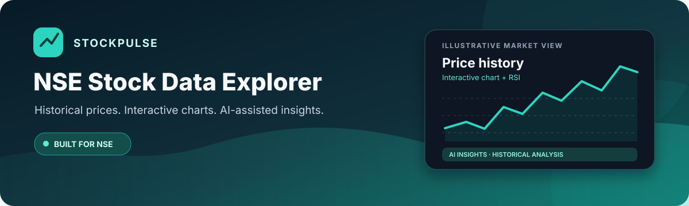

<p align="center">
  
</p>

<h1 align="center">StockPulse · NSE Stock Data Explorer</h1>

<p align="center">
  Explore historical NSE stock prices, interactive charts, technical indicators, and AI-assisted market summaries in one clean interface.
</p>

<p align="center">
  <a href="https://stock-market-nse-real-time.pages.dev/"><strong>🚀 Open Live Demo</strong></a>
  ·
  <a href="https://github.com/dARSHANdR4/Stock-Market_NSE-Real-Time"><strong>Source Code</strong></a>
  ·
  <a href="https://github.com/dARSHANdR4/Stock-Market_NSE-Real-Time/actions/workflows/stockpulse-browser-tests.yml"><strong>Automated Tests</strong></a>
</p>

<p align="center">
  
  
  
  
</p>

---

## ✨ What you can do

- **Historical stock lookup** — search NSE symbols or company names and select a target date.
- **Interactive price charts** — explore historical price movement with selectable chart ranges.
- **Technical analysis** — view the RSI (14) indicator alongside price history.
- **AI-assisted insights** — generate a concise, date-specific market summary through the Groq API.
- **Trend projection** — see the app's simple five-day linear trend projection; it is an illustration, not a reliable price prediction.
- **Personal watchlist** — save favourite symbols in browser storage.
- **Dark/light theme** — switch the interface to suit your preference.
- **Responsive layout** — core controls are tested at desktop, tablet, and mobile viewport sizes.

## 🖼️ Visual overview

<p align="center">
  
</p>

The banner at the top is a designed project illustration, not a live-data screenshot. The architecture diagram below shows the main service boundaries at a high level.

## 🧱 How it works

StockPulse uses a small frontend and serverless API layer:

1. **Frontend — Cloudflare Pages:** HTML, Tailwind CSS, JavaScript, and Chart.js render the stock lookup, charts, indicators, and watchlist.
2. **Historical data — Google Apps Script:** the web app calls an Apps Script endpoint backed by Google Sheets / Google Finance data.
3. **AI insights — Cloudflare Pages Functions + Groq:** the frontend requests `/api/insights`; the server-side function calls Groq so the Groq secret does not need to be embedded in the browser.
4. **Health check — `/api/health`:** a lightweight endpoint for deployment checks.

### Architecture

- **Browser → Pages Functions:** AI insight requests.
- **Browser → Apps Script:** historical stock data requests.
- **Pages Functions → Groq:** server-side AI completion using the `GROQ_API_KEY` environment secret.

## 🚀 Try the live app

**[Open StockPulse](https://stock-market-nse-real-time.pages.dev/)**

1. Enter an NSE ticker or company name (for example, `TCS` or `RELIANCE`).
2. Choose a target date.
3. Select **Get Stock Data**.
4. Explore the historical price, chart ranges, RSI chart, and AI-generated insights.
5. Use **View Watchlist** to open your saved symbols. On a stock result, use the star control to add or remove a favourite.

Data availability depends on the upstream Google Finance / Apps Script service. A missing date, market holiday, or upstream rate limit may affect the returned result.

## 🧪 Automated browser tests

GitHub Actions runs Playwright tests against the deployed site when changes are pushed to `main`. The suite checks:

- API health endpoint and invalid-symbol handling
- Historical data retrieval for TCS
- Stock page rendering, charts, AI insights, and persistent watchlist
- Theme persistence and future-date validation
- “Understanding the Engine” expand/collapse interaction
- Autocomplete suggestions and symbol selection
- Chart timeframe controls
- Mobile and tablet layout checks
- Browser JavaScript errors and watchlist open/close behaviour

**Latest known test result at the time this README was updated: 13 tests passed.** The badge above links to the current workflow status; check Actions for the latest run.

Run the suite locally against the deployed site:

```bash
npm install
npx playwright install chromium
BASE_URL=https://stock-market-nse-real-time.pages.dev npm run test:e2e
```

In Windows PowerShell, set the URL first:

```powershell
$env:BASE_URL = "https://stock-market-nse-real-time.pages.dev"
npm install
npx playwright install chromium
npm run test:e2e
```

## 🛠️ Deployment and configuration

The production frontend is hosted on **Cloudflare Pages**. The repository contains Pages Functions in `functions/api/`.

Required production configuration:

- Set **`GROQ_API_KEY`** as an encrypted secret in the Cloudflare Pages project settings.
- Keep the Groq key server-side. **Do not add API keys to `index.html`, README files, commits, or screenshots.**
- Keep the Google Apps Script web app deployed and its endpoint configured in the frontend.
- After a push to `main`, check the Cloudflare Pages deployment and the GitHub Actions test run.

For local work, use a local secrets file supported by your development runner and keep it out of version control. Never commit real credentials.

## 🧰 Tech stack

| Area | Technology |
|---|---|
| UI | HTML5, Tailwind CSS, vanilla JavaScript |
| Charts | Chart.js, financial chart plugin, Luxon date adapter |
| Historical data | Google Apps Script, Google Sheets / Google Finance |
| AI summaries | Groq API via Cloudflare Pages Functions |
| Hosting / serverless endpoints | Cloudflare Pages |
| Browser testing | Playwright + Chromium |
| CI | GitHub Actions |

## 📁 Repository layout

```text
.
├── .github/workflows/       # Playwright CI workflow
├── assets/                  # README banner and architecture artwork
├── functions/api/
│   ├── health.js            # Health endpoint
│   └── insights.js          # Server-side Groq proxy
├── tests/                   # Playwright browser tests
├── Code.gs                  # Google Apps Script data endpoint
├── index.html               # Frontend
├── package.json             # Test scripts and dependencies
└── playwright.config.js     # Playwright configuration
```

## ⚠️ Important notes

- AI-generated sentiment and summaries are informational and may be wrong or incomplete.
- The trend line is a simple mathematical projection, not a guarantee of future performance.
- This project is for exploration and learning; it does **not** provide personalised financial advice or a guaranteed buy/sell signal.
- Historical data and service uptime depend on third-party providers and their availability.

## 📜 Code usage and copyright

**Copyright © 2026 dARSHANdR4. All rights reserved.**

If you want to explore or modify StockPulse, please **fork this public repository first** and work in your own fork rather than making changes directly to the original project. Please retain attribution to the original StockPulse project and link back to this repository.

This repository does **not** include an open-source license. Please contact the repository owner to request permission before using the code commercially or redistributing it. This README notice explains the project's intended usage policy; it is not a substitute for a formal license or legal advice, and any rights or restrictions are subject to applicable law and GitHub's Terms of Service.

## 🤝 Contributing

Issues and pull requests are welcome. For a useful bug report, include the selected stock/date, expected behaviour, actual behaviour, and a screenshot with any private information removed.

---

<p align="center">
  Built with care for curious NSE market explorers. 📈
</p>


For the full copyright and permissions notice, see [COPYRIGHT](./COPYRIGHT).
